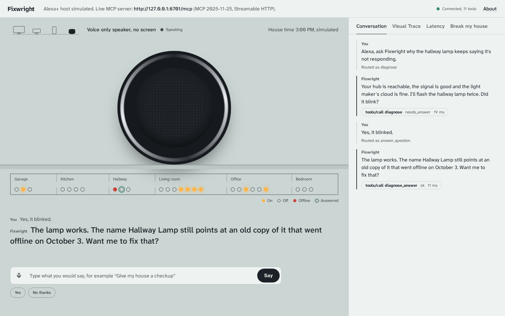
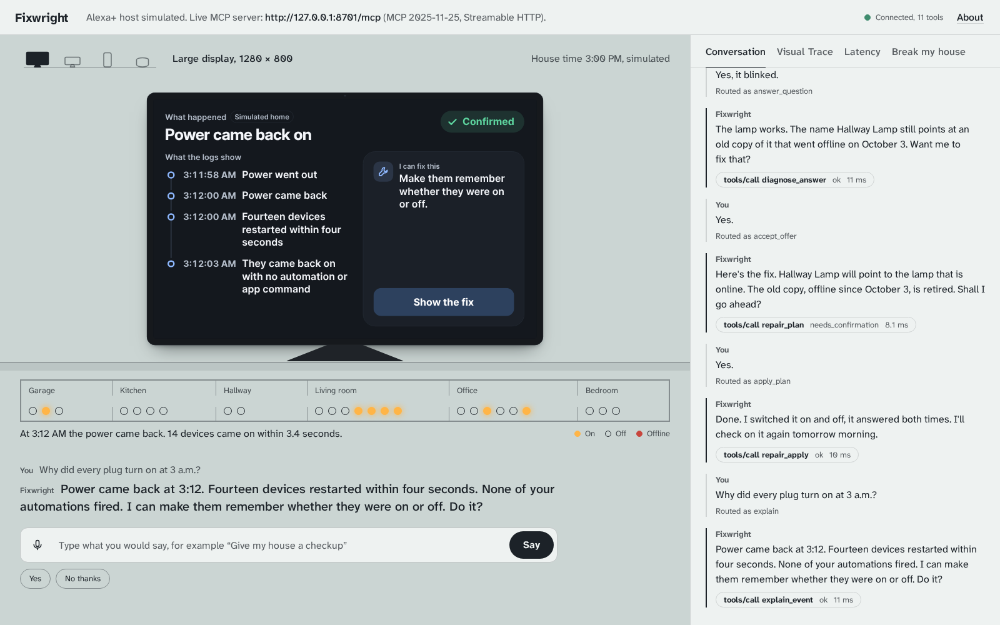
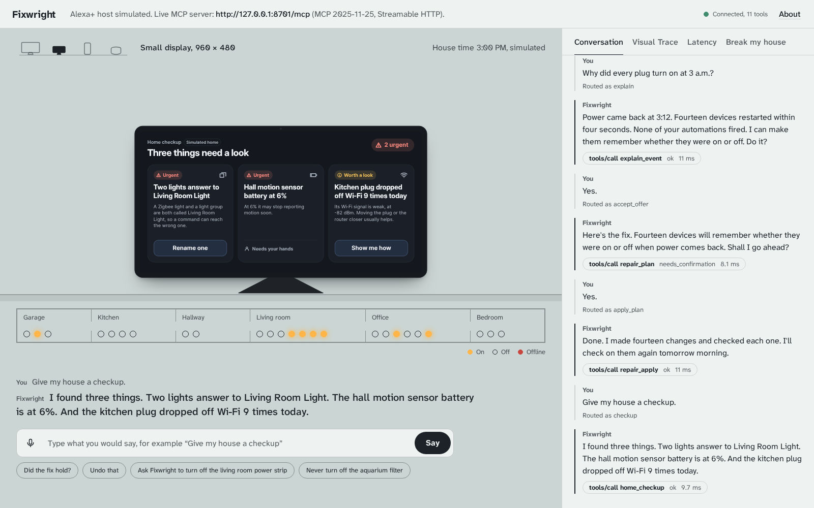

# Fixwright: self hosted MCP server (MCP spec 2025-11-25, Streamable HTTP) for Alexa+
**The home doctor for Alexa+. It finds the real fault, proves it, and fixes it, so nobody has to delete their smart home and start over.**

- Live MCP endpoint: `not deployed yet (run it locally with npm run dev:up)`
- Host simulator: `not deployed yet (run it locally with npm run dev:up)/`, health check: `not deployed yet (run it locally with npm run dev:up)/health`
- Demo video: https://youtu.be/wprZUWRlDCs
- Test house: [homefault](https://github.com/SamparkBhol/Fixwright/tree/main/packages/homefault), a separate MIT project with its own repo, used here as a git
  submodule pinned to `v0.1.0`
- License: MIT

The Alexa+ host is simulated in this repo, because Alexa+ add-on tooling is open to partners only. The
MCP server, the engines, the repair executor, the Home Assistant adapter and the push are real. The exact
split is [below](#what-is-real-and-what-is-simulated).

## For judges

The live demo needs no login, no token and no install.

- Host simulator: not deployed yet (run it locally with npm run dev:up)
- MCP endpoint: not deployed yet (run it locally with npm run dev:up) (MCP 2025-11-25, Streamable HTTP)

The host gives each browser its own demo house on first load. An MCP client that sends no token uses a
shared demo house that starts over every hour.

Five things to say (type them, or use the mic in a desktop browser):

1. "Why does the hallway lamp keep saying it's not responding?" Then "Yes, it blinked.", then "Yes." to
   hear the fix and "Yes." again to apply it.
2. "Why did every plug turn on at 3 a.m.?" Then "Yes." twice.
3. "Give my house a checkup."
4. "Alexa, ask Fixwright to turn off the living room power strip."
5. "Did the hallway lamp fix hold?", after jumping to the next morning in Break my house.

Then open **Break my house** to cause any of the ten faults, run the two safety net drills, reset the
house or jump the clock to 07:00 the next morning. Open **Visual Trace** to see the raw JSON-RPC requests
and responses with their timings: `initialize` at protocol 2025-11-25, `tools/list`, and each `tools/call`
with its `structuredContent`.

Which MCP clients work, and which are refused:

- Any MCP client that does not run inside a web page (Node, Python, desktop and command line clients),
  because the server checks the `Origin` header only when one is sent. I tested the TypeScript SDK client
  in Node and the plain fetch client below.
- The host page the Worker serves itself.
- A web page on another origin is refused with 403 unless its exact origin is listed in `ALLOWED_ORIGINS`,
  because the MCP spec requires servers to validate `Origin`.
- Requests must accept both `application/json` and `text/event-stream`; replies arrive as SSE.

The plain client, from a clone of this repo, with no MCP SDK (`initialize`, `tools/list`, then `diagnose`):

```sh
npm ci
npm run mcp:plain -- not deployed yet (run it locally with npm run dev:up)
curl not deployed yet (run it locally with npm run dev:up)/health
```

## The problem

When a smart home device stops answering, the official fix is often to delete everything and start over.
And when the house does something on its own, nobody can say why.

> "I'll say 'turn off the living room lights' and she'll tell me she can't find the device. I say the
> exact same thing again five seconds later and suddenly it works."
> r/alexa, 9 September 2026: https://www.reddit.com/r/alexa/comments/1wbmeqx/

> "Customer support had me completely remove all of the smart devices and said I had to rebuild all of my
> routines from scratch."
> r/alexa, 10 October 2026: https://www.reddit.com/r/alexa/comments/1x25meq/

> "I've had to re-add 55 Hue devices six times over the past year... That is an assistant I would pay
> money for."
> The Verge, 8 October 2026: https://www.theverge.com/tech/1007565/amazon-alexa-plus-review-one-year-echo-show-dot-max

> "When I checked the activity there wasn't any. I asked Alexa what happened and got half a ton of BS
> including might have been a power failure or a router problem."
> r/alexa, 23 September 2026: https://www.reddit.com/r/alexa/comments/1wo3p68/

The quoted words belong to their authors and are not covered by this repo's MIT license (see `NOTICE`).

In my read of 10,811 r/alexa and r/amazonecho posts (February 2025 to 14 October 2026) and 18,007
Google Play reviews, smart home device health was about 2.3% of negative Play reviews and about 3% of
r/alexa posts since August. It is not the loudest complaint. It is the one an add-on can fix, and the one
with people saying they would pay for it.

## What Alexa+ already does, and what Fixwright adds

Alexa+ already tells you when a device stops responding, and "Alexa, why did you do that?" explains what
Alexa itself did. Fixwright adds three things:

1. **The household as a sensor.** When no sensor can answer, it asks the person in the room: "I'll flash
   the hallway lamp twice. Did it blink?"
2. **A fix applied once, with proof.** A dry run, one spoken yes, each step read back, and an automatic
   rollback when a read back does not match.
3. **A check the next morning.** At 07:00 it looks at what happened overnight and pushes the result.

Where the AI is: Alexa+'s own model holds the conversation and calls Fixwright's tools. The tools decide
and act, and nothing is called confirmed without a logged event behind it.

## What Fixwright does

| | |
| --- | --- |
| **Diagnoses with probes** | "Why does the hallway lamp keep saying it's not responding?" Fixwright tests likely causes in order: hub reachable, link quality, vendor cloud, account link, duplicate names, registry. It picks each next probe by expected information gain divided by how disruptive it is, respects quiet hours, and stops when one cause passes 0.9. |
| **Uses the person as a sensor** | When no sensor can answer, it asks the person in the room: "I'll flash the hallway lamp twice. Did it blink?" It flashes the lamp itself, then takes "yes, it blinked", "I heard it click", "haan" (yes) or "nahi jala" (it did not light). Answers count as a noisy sensor (sensitivity 0.92, specificity 0.95 by default), not as truth. |
| **Repairs with proof** | A dry run in plain sentences, one explicit yes, then each step runs at most once, is read back, and rolls back automatically on a mismatch. A repair card with undo. Break my house has two safety net drills that show it live: a fix that does not stick is put back ("Put back the way it was"), and a lamp that loses power overnight fails the morning check, whose card offers to diagnose it again. |
| **Checks again the next morning** | At 07:00 household time it checks what happened overnight and sends a real push: "Hallway lamp answered all 9 commands overnight. Repair confirmed." |
| **Explains events** | "Why did every plug turn on at 3 a.m.?" gets "Power came back at 3:12. Fourteen devices restarted within four seconds. None of your automations fired." Then one fix: make them remember their last state. When the logs do not back an answer, it says it can't tell. |
| **Runs a checkup** | 3 to 5 findings, most severe first: two lights answering to one name, a battery at 6%, a plug that dropped off Wi-Fi 9 times today, old copies left by a pairing again, dead automation triggers, plugs that turn on after a power cut. |
| **Protects loads** | "Alexa, ask Fixwright to turn off the living room power strip" gets "That strip runs the aquarium filter, which you marked protected. I'll turn off the lamp on it instead." |

| Diagnose (large display) | Voice only, same conversation | Explain an event | Checkup (small display) |
| --- | --- | --- | --- |
|  |  |  |  |

## Why it belongs in Alexa+

- **A speaker in every room makes the household the missing sensor.** "Did it blink?" is a question only
  an assistant in the room can ask at the right moment. No phone app gets that answer.
- **Alexa owns the yes turn.** Every repair is a dry run read aloud and a spoken yes, so consent is
  explicit, and a signed single use token binds it to that one plan.
- **Voice first, proof on the screen.** The speech carries the answer on a speaker. On an Echo Show style
  display the same result shows the probes, the cause bars, the diff and the read back.
- **It cannot speak first, so it pushes.** Add-ons cannot start a conversation today, so the next morning
  check arrives as a push notification.
- **It reads only what the household links.** Fixwright reads a Home Assistant hub (or the SimHome
  twin). It never reads Alexa's own device list or activity.

## What is real and what is simulated

Real (runs in this repo, tested end to end):

1. The MCP server: a Cloudflare Worker with `createMcpHandler` from `@modelcontextprotocol/server` 2.2.0,
   protocol 2025-11-25 over Streamable HTTP (2025-06-18 and 2025-03-26 accepted), 11 tools with input
   and output schemas, 3 MCP Apps views.
2. The diagnosis, explanation, checkup and repair planning engines (`@fixwright/engine`) and the claim
   checker that drops any sentence not backed by a logged event.
3. The household Durable Object: append only event ledger, plans with signed single use confirm tokens,
   the repair executor (each step claimed once, read back, rolled back), undo, protected loads, and one
   alarm that runs the due queue for the next morning check.
4. The Home Assistant adapter: REST and WebSocket against a real Home Assistant 2026.9.4, used in
   `npm run e2e:ha` (power cut, explain, repair, read back over REST, undo).
5. The push: an HTTP POST to ntfy (`ntfy.sh` when deployed; a local receiver in tests).
6. The MCP Apps views (`@modelcontextprotocol/ext-apps` 2.0.3) on a separate sandbox origin.
7. The host simulator as an MCP client: it does real `initialize`, `tools/list`, `resources/read` and
   `tools/call` against the server.
8. The HomeTruth benchmark and its LLM only baseline (gpt-oss-20b on llama.cpp through the Strands
   Agents TypeScript SDK).
9. The Agent Skill in `skills/fixwright-home-triage`, validated with skills-ref 0.1.1.

Simulated, and labelled as simulated on screen:

1. The Alexa+ host itself (`apps/host`). The banner says "Alexa+ host simulated."
2. The SimHome house (47 entities in 6 areas), its power circuits, power cuts and restores.
3. Vendor cloud outages.
4. QR hub relinking for an expired account link (guided, not performed).
5. The "next morning" clock jump.
6. The person's spoken answers (typed in tests; the video uses synthesized voices).
7. The devices behind the real Home Assistant are template entities (simulated hardware), and the
   Home Assistant run is local, not a household's own hub. The views tag it "Real Home Assistant, demo
   devices".
8. The two safety net drills in Break my house (a fix that does not stick, a lamp that loses power
   overnight). They are injected into SimHome only and fire once.

## Architecture


<details>
<summary>Text version</summary>

```
 Alexa+ style host (simulated)      Any MCP client           Phone (ntfy app)
   | MCP 2025-11-25, Streamable HTTP  |                          ^
   v                                  v                          |
 +-- Worker "fixwright" --------------------------------------+  |
 | host check -> CORS / origin -> RateLimitDO -> 64 KB cap    |  |
 | -> household token (HMAC) -> /mcp createMcpHandler         |  |
 |    (11 tools, 3 ui:// views)  /health /demo/* /assistant/  |  |
 |    route  static host files                                |  |
 +-----------------------------+------------------------------+  |
                               | RPC tool(household, name, input)
                               v                                 |
 +-- HouseholdDO (SQLite, one per household) -----------------+  |
 | engine: diagnose, explain, checkup, plan, claim checker    |  |
 | executor: signed token, step once, read back, rollback     |--+ next morning push
 | ledger, sessions, plans, repairs, protected, due queue     |
 +---------------+------------------------------+-------------+
                 | HomeAdapter                  | HomeAdapter (linked hub)
                 v                              v
   SimHome twin (homefault, simulated)   Home Assistant 2026.9.4 (REST + WebSocket)

 Views: fixwright-sandbox Worker on a second origin, double iframe, postMessage bridge to the host.
 Offline: bench/ runs the engine and an LLM only baseline on homefault scenarios.
```
</details>

## Tools

| # | Tool | What it does | Hints set to true | View |
| --- | --- | --- | --- | --- |
| 1 | `home_checkup` | Scan the house: 3 to 5 findings, most severe first, each with an `issue_id` | `readOnlyHint`, `idempotentHint` | carousel |
| 2 | `diagnose` | Find why one device misbehaves now; may flash it and ask a question (`needs_answer`). The flash switches the device, so it is not marked read only. | none | stepper |
| 3 | `diagnose_answer` | Pass the person's reply, word for word (English and Hindi) | none | stepper |
| 4 | `explain_event` | Explain something the house did, from its logs, or say it can't tell | `readOnlyHint`, `idempotentHint` | stepper |
| 5 | `repair_plan` | Dry run: plain sentence diff, steps, `confirm_token`, expiry | `readOnlyHint`, `idempotentHint` | stepper |
| 6 | `repair_apply` | Apply a plan after an explicit yes: each step once, read back, rollback. Marked destructive because it overwrites names and settings, and once the morning check passes the old copy leaves the registry for good. | `idempotentHint`, `destructiveHint` | repair card |
| 7 | `repair_status` | How a repair is holding up, including the next morning check | `readOnlyHint`, `idempotentHint` | repair card |
| 8 | `undo` | Put an applied repair back, with read back | `idempotentHint` | repair card |
| 9 | `protect_device` | Mark a device that must never be switched off | `idempotentHint` | |
| 10 | `switch_device` | Switch a device unless that cuts a protected load; offers an alternative | `idempotentHint` | |
| 11 | `refresh_view` | For views only (`visibility: ["app"]`): latest result for an open view | `readOnlyHint`, `idempotentHint` | |

`openWorldHint` is false on every tool (`packages/protocol/src/tool-defs.ts`).

Every tool returns one spoken line in `content` and `structuredContent` matching its `outputSchema`.
Ids chain from one call to the next (`checkup_id` to `issue_id` to `plan_id` to `repair_id`), so a host can
finish a multi step flow and resume it on another device. Failures return `isError: true` with a plain
speech line.

## The invariant

Fixwright never says Confirmed without logged events behind every sentence, never switches off a
protected load, and runs each repair step at most once, with read back and automatic rollback.

## HomeTruth benchmark

Can a plain LLM given the same logs do what Fixwright does? HomeTruth (`bench/`) runs three agents on the
same homefault scenarios: **Fixwright** (the live product's router and engine), **B1** (an LLM with the
raw logs and the symptom) and **B2** (the same LLM with the same logs plus the answers the person gave
Fixwright). The LLM is gpt-oss-20b (Apache-2.0) on llama.cpp on CPU, called through the Strands Agents
TypeScript SDK, with greedy decoding, one slot and no prompt cache so answers reproduce. An LLM answer
counts as confirmed at confidence 0.9 or above. The simulated person answers truthfully 90% of the time.
The deciding set is a stratified held out sample of 100 scenarios (10 per cause, seed 1), fixed before any
held out baseline answer existed. The full run finished on 17 October 2026.

**The result, plainly.** On the deciding set, the LLM that read the answers Fixwright collected (B2) matched
Fixwright on top 1 accuracy and on false confirmations. By the rule I set before the run,
that moves the headline from "beats an LLM" to the work around the diagnosis:

1. **Fixwright's questions are what help.** The same LLM went from 71 of 100 right (B1) to 83 of 100 (B2)
   once it had the answers to Fixwright's questions ("Did it blink?"). On the same 100 scenarios, the
   answers turned 12 wrong diagnoses right and no right ones wrong (exact McNemar p 0.0005). All 12 are
   among the 38 scenarios where Fixwright asked the person something.
2. **It says can't tell instead of guessing.** When Fixwright names a cause, it is right 78 of 81 times
   (96%). B2 is right 83 of 97 times when it names one (86%). The price is coverage: Fixwright says can't
   tell on 19 of 100, B2 on 3.
3. **The rest is a loop an LLM alone does not run.** It cannot run the probes, flash the lamp, apply the
   fix once, read it back, roll it back or check the next morning. HomeTruth does not score that part; the
   golden path e2e and the Home Assistant beat test it.

Held out sample, n = 100 for each agent. Brackets hold 95% Wilson intervals, in percent.

| Agent | Top 1 | False confirmed | Can't tell | Right when it names a cause | p95 time per scenario |
| --- | --- | --- | --- | --- | --- |
| Fixwright | 78 (68.9 to 85.0) | 3 (1.0 to 8.5) | 19 (12.5 to 27.8) | 78 of 81, 96.3% (89.7 to 98.7) | 3.8 ms |
| B1: LLM, logs only | 71 (61.5 to 79.0) | 5 (2.1 to 11.2) | 4 (1.6 to 9.8) | 71 of 96, 74.0% (64.4 to 81.7) | 166.7 s |
| B2: LLM, logs and the person's answers | 83 (74.5 to 89.1) | 3 (1.0 to 8.5) | 3 (1.0 to 8.5) | 83 of 97, 85.6% (77.2 to 91.2) | 158.7 s |

Times are per scenario on one shared 16 vCPU machine with no GPU: Fixwright's engine in process, the LLM on
8 CPU threads. They describe this setup, not LLMs in general. In 62 scenarios Fixwright asked nothing, so
B2's request was byte identical to B1's and reused its answer and its time.

| 20 reconstructed incidents | Top 1 | False confirmed |
| --- | --- | --- |
| Fixwright | 16 of 20 (58.4 to 91.9%) | 0 (0 to 16.1%) |
| B1 | 16 of 20 (58.4 to 91.9%) | 2 (2.8 to 30.1%) |
| B2 | 17 of 20 (64.0 to 94.8%) | 2 (2.8 to 30.1%) |

Twenty incidents are too few to tell the agents apart; every interval overlaps.

Fixwright on all 720 scenarios (dev 500, held out 200, incidents 20): top 1 591 of 720, 82.1% (79.1 to
84.7); false confirmed 24 of 720, 3.3% (2.2 to 4.9); right when it names a cause 591 of 615, 96.1% (94.3 to
97.4). 21 of the 24 false confirmations come from one router path: a question about an automation that did
not run (dead_trigger) goes to explain_event, which has no detector for something that did not happen.
With the router off, false confirmations fall to 4 of 720 (0.6%) and top 1 to 79.2% (570 of 720).

Kill switch verdict: **fires**. On the held out sample, B1 and B2 each match Fixwright on top 1 and on false
confirmations by overlapping 95% intervals. The paired exact McNemar tests agree that the data cannot
separate them (B1: p 0.35 on top 1 and 0.73 on false confirmations; B2: p 0.46 and 1.00).

Where each side wins on the held out sample (correct of 10 per cause): Fixwright leads on device_power_lost
(8, against 3 for B1 and 4 for B2), hub_down (10 against 7 and 7), stale_duplicate (9 against 5 and 8) and
wifi_network_changed (8 against 1 and 8). The LLM leads on power_on_default_on (2 against 9 and 9;
Fixwright said can't tell 8 times), name_collision (5 against 9 and 10) and dead_trigger (7 against 10 and
10, with Fixwright's 3 false confirmations).

**What these numbers do not show.**

- That Fixwright finds faults in real homes, with real devices and real people.
- Whether people answer "Did it blink?" as reliably as the simulated person.
- Repairs: HomeTruth scores the diagnosis only, not the dry run, apply, read back or rollback.
- How a frontier LLM, more reasoning, or an LLM agent with probe tools would do. The baseline is one 20 B
  open model on CPU at low reasoning effort with a 1,024 token cap, called once per scenario with no tools.
- Whether the ten causes cover the faults real homes have.

Caveats. The 700 generated scenarios come from homefault's generator, which shares the ten cause library
with Fixwright's engine, and I wrote both, so the setup favours Fixwright. The held out seeds were kept for
reporting, but held out smoke runs were seen during the build. The 20 incidents are reconstructions of dated
public reports, not recordings of homes. There is one seed each for the sample, the person and the model.

Every number comes from `bench/results/`. `HOMETRUTH.txt` is the plain text account with intervals,
settings, timings and caveats; `hometruth-heldout-b1b2-n100.*` and `hometruth-incidents-b1b2.*` hold the
paired runs. The B1 against B2 comparison is computed from the case rows of
`hometruth-heldout-b1b2-n100.json` with the runner's exact McNemar test (`bench/src/stats.ts`). The scenario
generator is an event level simulator separate from the engine's model, with timing jitter, dropped log
rows (0 to 15%), correlated failures and distractors. `bench/README.md` has the commands to rerun it.

## AWS Builder: Strands Agents SDK

The AWS service in this project is the Strands Agents SDK for TypeScript (`@strands-agents/sdk` 1.19.0). It
runs the LLM baselines of the HomeTruth benchmark, offline, against a model on my own machine. No Bedrock,
AgentCore, SageMaker or other AWS runtime service is used, and the live add-on runs no model at all.

| File | What it does with Strands |
| --- | --- |
| `bench/llm/src/strands-client.ts` | `createLocalModel()` builds a Strands `OpenAIModel` on Chat Completions (`api: 'chat'`) pointed at llama-server on 127.0.0.1:8771, and passes the seed, `cache_prompt: false`, the reasoning effort and a strict JSON schema for `{cause_id, confidence, explanation}` through `params`. `strandsVerdict()` creates a fresh Strands `Agent` per scenario (diagnosis system prompt, retries off), calls `invoke()` once, validates the answer with zod, and maps Strands errors (`MaxTokensError`, `ContextWindowOverflowError`, `StructuredOutputError`) to the benchmark's failure kinds. |
| `bench/src/agents/llm.ts` | The B1 and B2 agents. Each scenario is one Strands call; a plain fetch client runs only if Strands got no answer from the server. |
| `bench/llm/strands_smoke.ts` | Checks both Strands JSON modes (`json_schema`, and Strands' own `structured_output` through tool calling) against the local server, next to the fetch client (`bench/llm/results/strands_smoke.json`). |
| `bench/src/cli.ts`, `bench/scripts/hometruth-full.sh` | Run the benchmark. `--mode` picks the Strands JSON mode, and every result file records the Strands version. |

In the final run every baseline answer came through Strands: 165 calls (held out B1 100 and B2 38,
incidents B1 20 and B2 7), 0 fetch fallbacks and 0 failures. The other B2 cases reused a byte identical B1
request (`bench/results/HOMETRUTH.txt`, TIMINGS). The model setup and rerun steps are in
`bench/llm/README.md`.

## Measured on the local stack

17 October 2026, AMD Ryzen 9 5950X, Node 22.22.1, wrangler 4.144.0 (`wrangler dev --local`), headless
Chromium from Playwright 1.63.0, under a load average of about 11 from other builds. Raw numbers in
`docs/integration/LATENCY.json` and `docs/integration/CHECK.txt`.

- Golden path end to end (`npm run e2e`): 11 of 11 tests, every scripted line asserted word for word, plus
  the safety net beat (a rollback and a failed morning check, on a second household), 0 console errors,
  0 failed requests.
- Home Assistant beat (`npm run e2e:ha`): 5 of 5 tests. After the repair, Home Assistant's own REST API
  shows every `select.*_power_on_behavior` as `previous`; after undo, `on` again.
- MCP round trips measured in the browser over 50 full golden runs:

| Method | n | p50 ms | p95 ms |
| --- | --- | --- | --- |
| initialize | 50 | 11.9 | 20.4 |
| tools/list | 50 | 7.2 | 12.6 |
| tools/call diagnose | 50 | 12.5 | 19.0 |
| tools/call diagnose_answer | 50 | 10.1 | 18.9 |
| tools/call repair_plan | 100 | 8.5 | 15.4 |
| tools/call repair_apply | 100 | 13.2 | 18.6 |
| tools/call explain_event | 50 | 10.1 | 17.8 |
| tools/call home_checkup | 50 | 16.6 | 27.6 |

- workerd CPU: 9.091 ms per HTTP request on average, 200 ms per full golden run, counting static files and
  a new household each run, measured over the same 50 runs under a load average of 10.8 to 12.4
  (`docs/integration/LATENCY.json`). Cloudflare's own CPU accounting is checked after deploy in Workers
  Logs.
- Root `npm run check` on 18 October 2026: exit 0, 2,057 tests passed and 23 skipped. adapter-ha 135
  (19 live Home Assistant tests skipped), engine 398, homefault 359, protocol 258, router 190, host 52 unit
  and 24 e2e, sandbox 17, server 103 (1 skipped), views 152 unit and 247 visual, bench 92 (3 skipped),
  video 30 (`docs/integration/CHECK.txt`).

## Run it locally

Needs Node 22.18 or later. No account, no Docker.

```sh
git clone --recurse-submodules https://github.com/SamparkBhol/Fixwright fixwright && cd fixwright
npm ci              # also fetches packages/homefault if the clone skipped submodules
npx playwright install chromium   # headless Chromium for the e2e and visual tests
npm run dev:up      # builds views, sandbox and host, then starts:
                    #   http://127.0.0.1:8701  MCP server at /mcp and the host simulator at /
                    #   http://127.0.0.1:8702  sandbox origin for the views
                    #   http://127.0.0.1:8703  local ntfy receiver (GET /_received lists pushes)
npm run dev:down    # stops all three
npm run e2e         # the golden path in headless Chromium (starts and stops the stack)
npm run e2e:ha      # optional: the Home Assistant beat, needs a local Home Assistant (below)
npm run check       # every workspace's typecheck and tests
```

The scripts work from a fresh clone and need nothing outside it; PID files and logs go to `.tmp/fixwright-dev`.
They were tested on Linux. macOS has no `setsid`, so there they give each process its own group with job
control instead.

`npm run e2e:ha` is the one step that needs more than Node: a Home Assistant 2026.9.4 install without Docker
(a Python 3.14 venv with `homeassistant==2026.9.4`, started with `--skip-pip`). Point `HASS_BIN` at its `hass`.

Open `http://127.0.0.1:8701/`, type or say "Why does the hallway lamp keep saying it's not
responding?", answer "Yes, it blinked", and say "Yes" twice. Then try "Give my house a checkup", the
Break my house tab, and the Visual Trace.

Any MCP client works against the same URL. With no SDK at all, plain `fetch` and JSON-RPC
(`video/src/plain-mcp.ts`: `initialize`, `tools/list`, then `diagnose`):

```sh
npm run mcp:plain -- http://127.0.0.1:8701/mcp      # or the live URL
```

With the TypeScript SDK client:

```ts
import { Client, StreamableHTTPClientTransport } from '@modelcontextprotocol/client';

const client = new Client(
  { name: 'my-client', version: '1.0.0' },
  { supportedProtocolVersions: ['2025-11-25'], versionNegotiation: { mode: 'legacy' } },
);
await client.connect(new StreamableHTTPClientTransport(new URL('http://127.0.0.1:8701/mcp')));
const { tools } = await client.listTools();                              // 11 tools
const checkup = await client.callTool({ name: 'home_checkup', arguments: {} });
```

## Deploy (Cloudflare Workers Free, $0)

```sh
npm ci
npx wrangler login                     # or export CLOUDFLARE_API_TOKEN (Workers Scripts edit)

# 1. The sandbox origin for the views
npm run build -w @fixwright/sandbox
cd apps/sandbox && npx wrangler deploy --var HOST_ORIGINS:https://fixwright.<subdomain>.workers.dev && cd ../..

# 2. Views and host, built against that sandbox
npm run build -w @fixwright/views
SANDBOX_URL=https://fixwright-sandbox.<subdomain>.workers.dev/sandbox.html npm run build -w @fixwright/host

# 3. The MCP server
cd apps/server
npx wrangler secret put CONFIRM_SECRET  # 32+ random characters, e.g. openssl rand -base64 48
npx wrangler deploy
curl https://fixwright.<subdomain>.workers.dev/health
```

| Var (`apps/server/wrangler.jsonc`) | Default | Set it to |
| --- | --- | --- |
| `ALLOWED_ORIGINS` | the local host dev server | exact origins of any host on another origin (the page the Worker serves itself is always allowed) |
| `PUBLIC_HOSTNAMES` | `localhost,127.0.0.1,fixwright.*.workers.dev` | add a custom domain if you route one |
| `NTFY_BASE` | `https://ntfy.sh` | keep, or your own ntfy server |
| `ALLOW_HA_LINK` | `"0"` | `"1"` only for a private demo with a public Home Assistant URL |
| `DEMO_START` | `15:00` | `HH:MM` starts every new house at that Los Angeles time on the current day (the demo uses 15:00); `now` uses real time |
| `RATE_MCP_PER_MIN`, `RATE_DEMO_PER_MIN` | 240, 30 | requests per IP per minute |

| Secret | Purpose |
| --- | --- |
| `CONFIRM_SECRET` | Signs repair confirm tokens and household tokens. Without it, signing routes answer 503. |

The first deploy runs Durable Object migration `v1` (SQLite classes `HouseholdDO` and `RateLimitDO`).

## Alexa+ certification readiness

Mapped against the Alexa+ add-on
[Functional Requirements](https://developer.amazon.com/docs/alexaplus/add-ons/functional-requirements.html)
and [Policy Requirements](https://developer.amazon.com/docs/alexaplus/add-ons/policy-requirements.html).
Both pages were last modified on 21 July 2026 and were read again on 18 October 2026. Fixwright cannot be
submitted for certification, because the Alexa+ toolkit, CLI, simulator and Local Inspector are open to
partners only. Each row gives the requirement's number and title as Amazon writes them, and quotes the
lines that decide the status.

**Functional requirements**

| # | Requirement | Status | How Fixwright meets it, or why not |
| --- | --- | --- | --- |
| 1 | Context & Continuity: "An add-on maintains conversational context so the customer never repeats themselves and can pick up where they left off." | Mostly | "Transfer context when the customer continues on a different device": diagnoses, plans and repairs live in the household's Durable Object under stable ids, and the golden path moves from a large display to voice only to a phone in one conversation. "Preserve context or provide a clear expiry message after session": a plan carries `expires_at`, and applying a stale one says "That fix waited too long, so I didn't apply it. Want me to plan it again?" Each tool takes one id plus its own inputs, so one detail changes without the others. Gap: "Clear all accumulated context when the customer explicitly requests a fresh start". There is no "start over" command; a new request starts a new diagnosis with new ids. |
| 2 | Error Handling: "every error must give the customer a clear path forward with no technical jargon." | Mostly | "Provide a message when the service is unavailable": failures return `isError: true` with "I couldn't reach your hub just now. Try again in a minute." "Surface no API codes, tool names, JSON, or internal IDs": `speechProblems` in `packages/protocol/src/speech.ts` rejects ids, entity ids, tool names, brackets and links, and the engine tests run it on every spoken template. An answer it cannot read is asked again once, more plainly. Gap: "Surface an interim 'still working' message when tool calls are slow". There is none. Every tool call stayed under 30 ms at p95 locally; deployed latency is not measured yet. |
| 3 | Device Availability: "Add-on must work on every supported device with appropriate modality adaptations." | Meets | The golden path runs on a large display, a small display, a phone and a speaker with no screen, in one conversation (`e2e/golden.e2e.ts`). No feature needs a screen. |
| 4 | Onboarding & Discovery: "Return a useful, contextually relevant summary when the customer asks 'What can you do?'" | Meets in the host | The router answers "what can you do" with "I can find out why a device is acting up, explain something your home did, or give your house a checkup. Try: why is the hallway lamp not responding?" Every golden path utterance is asserted in the e2e. There is no store listing yet to check against. |
| 5 | Add-On Metadata: "An add-on's store listing must be accurate, complete, and build customer confidence before they enable it." | Not yet | No store submission is possible without partner access. Ready: the name, the category and more than three distinct example phrases from the golden path. Not written: the description, the privacy policy and terms of use URLs, and the icon. |
| 6 | Account Linking. Applies to "add-ons with account linking". | Partly | Households use a bearer token `hh_...` signed with HMAC. A forged token gets 401 (`apps/server/test/integration/worker.test.ts`), and calls from one household on another's ids return errors with no data. With no token, calls go to a shared demo household, which is the guest experience. Linking a Home Assistant hub is built and tested against a real Home Assistant 2026.9.4, and is off on the public demo (`ALLOW_HA_LINK` is `"0"`). Not built: "Complete OAuth linking on every supported endpoint" through Amazon's consent flow. |
| 7 | Search & Discovery. Applies to "add-ons with search or discovery features". | Not applicable | Fixwright finds a device by the name the person says. It has no search feature. |
| 8 | Transaction Flow. Applies to "add-ons with transactions, bookings, or purchases". | Not applicable, followed anyway | No payments or bookings. Repairs still follow the consent rules: every change is a dry run read aloud, then a signed single use `confirm_token` after an explicit yes. Reusing a token is refused ("That fix is already applied."), which covers "Detect and prevent duplicate transactions". `repair_status` gives the current state when asked. |
| 9 | Voice-Only Experience: "Your add-on completes every critical flow entirely by voice on devices without screens." | Partly | Every flow completes by voice. A checkup returns 3 to 5 findings ("a maximum of 5 options"). A repair needs a yes after its changes are read ("Read back all key details and require explicit 'yes'"). Gap: "Never reference visual elements". A checkup with more than three findings says "There are two more on the screen.", and a failed repair or undo step says it "needs a look on the screen", on every device, because a tool call cannot tell which device will speak (`FRICTION_LOG.md` 1.4). The Agent Skill tells assistants to reword both lines on a speaker. |
| 10 | Cross-Modal Consistency: "Your add-on ensures voice and visual content agree" | Mostly | Speech and views render from the same `structuredContent`. Each result gets a fresh view, and a repair card refreshes itself through `refresh_view` when its morning check is due. Gap in my simulated host, against "Update visuals simultaneously with voice": a tool with no view (`switch_device`, `protect_device`) leaves the previous card on screen. |
| 11 | Visual Presentation: "Your add-on's visual elements are clear, readable, and functional on all display devices." | Mostly | Views follow the Alexa+ MCP add-on design guide (768x480 base, 48 px targets, 4.5:1 contrast, light and dark). 247 visual tests render every state at 1280x800, 960x480 and 390x844 and fail on any element outside the viewport. Taps call the same tools as voice ("tapping produces the same result as the voice equivalent"). On a speaker the host tears the views down. Not built: "Auto-scroll long content in sync with TTS". |
| 12 | Video Playback. Applies to "video playback add-ons". | Not applicable | |
| 13 | MCP Tool Validation: "Every tool returned by your server's tools/list endpoint must be invocable" | Meets | 11 tools, each with a zod derived `inputSchema` and `outputSchema`. Inputs are validated before acting, and invalid parameters or unknown ids return `isError: true` without a crash. Ids chain from checkup to issue to plan to repair ("return stable identifiers"). Five descriptions say which tool to use instead, and `refresh_view` says it is for views only. `diagnose_answer` lists English and Hindi answers ("haan" for yes, "nahi jala" for it did not light) for "Include common synonyms". The uptime probe and the server's integration test check that tools/list returns all 11. |
| 14 | Category Definition: "Select a category that matches your add-on's primary customer intent." | Ready | Smart Home. |

**Policy requirements**

| # | Requirement | Status | How Fixwright meets it, or why not |
| --- | --- | --- | --- |
| 1 | Brand & Trademark Compliance | Meets | Its own name. No Alexa, Amazon or Echo marks in the name or icon, and none will go in search keywords. The host draws generic device outlines, shows no Alexa logo, and its voices do not imitate Alexa. No real person's name, likeness or voice. |
| 2 | Content Standards | Meets | Device diagnosis and repair only. |
| 3 | Data Privacy & Collection | Open question | Fixwright reads device state only from a hub the household links (Home Assistant) or the simulated house, and never reads Alexa's device registry or activity. Whether a hub the customer links counts as "data about the customer's Alexa environment" has been asked of the organizers. Inputs are capped (a symptom is at most 500 characters) and every text field serves the diagnosis. Not yet: the privacy policy and terms of use URLs, and the permission prompt shown once before first use. |
| 4 | Child Safety | Meets | Not aimed at children, and collects no data about them. |
| 5 | Dangerous Substances & Gambling | Not applicable | |
| 6 | Intellectual Property & Duplication | Meets | Original code under MIT. The host's fonts (Atkinson Hyperlegible Next and Mono) are under the OFL. The baseline model (gpt-oss-20b, Apache-2.0) and llama.cpp (MIT) run only in the benchmark and do not ship in the add-on. |
| 7 | Image & Media Standards | Meets so far | No images of Amazon devices in any asset. The icon is not made yet; it will carry only the wordmark ("Icon must contain only your brand name or wordmark"). |
| 8 | Metadata Accuracy | Not yet | No listing exists. The benchmark numbers in this README come from the final run; the URLs stay placeholders until the deploy, and none of them can reach a listing. |
| 9 | Information Attribution | Meets | Every factual sentence is about the household's own devices and cites ledger events; the claim checker drops any that do not. Vendor status is named by vendor ("the Hue cloud is fine"). |
| 10 | Business Eligibility | Meets | Built for households. Deterministic engines decide, so the add-on is not a relay to an LLM. |
| 11 | Account Linking & Enablement. Applies to "add-ons with account linking". | Not yet | Hub linking is a demo route, off on the public demo, and QR relinking is simulated. Production needs "OAuth 2.1 + PKCE through Amazon's consent infrastructure": a QR code on displays and a push on speakers. |
| 12 | User-Generated Content. Applies to "Social/UGC add-ons". | Not applicable | No social features. Answers are read by rules, not by a model, so text inside an answer cannot steer it. |
| 13 | Healthcare & Medical Content. Applies to "Health, Medical, Drug, and Food add-ons". | Not applicable | No health content and no life saving claims. `protect_device` names an aquarium filter, freezer, fridge, grow light or pump as examples, and a protocol test fails if any tool description says medical, patient or life saving. |
| 14 to 17 | Financial Services & Transactions, Reservations & Bookings, Retail Shopping, Music & Video | Not applicable | |

## Agent Skill

`skills/fixwright-home-triage/SKILL.md` follows the [Agent Skills specification](https://agentskills.io/specification)
and teaches any agent the checkup, diagnose, answer, plan, explicit yes, apply and status flow, the consent
rules, the protected load rule, and how to speak on a device with no screen. Its frontmatter uses only the
spec's fields: `name` matches the folder, `description` is 746 characters (the limit is 1,024),
`compatibility` is 185 (limit 500), and `metadata` maps strings to strings. The body is 151 lines, under
the spec's 500. It passes `agentskills validate` (skills-ref 0.1.1, run again on 18 October 2026).

## Repository map

| Path | What it is |
| --- | --- |
| `packages/protocol` | Shared types, zod schemas for every tool input and output, tool definitions, ids |
| `packages/engine` | Diagnosis, explanation, checkup, claim checker, repair planner, phrasing (pure TypeScript) |
| `packages/router` | Deterministic utterance router used by the host and `/assistant/route` |
| `packages/homefault` | Git submodule: the separate [homefault](https://github.com/SamparkBhol/Fixwright/tree/main/packages/homefault) repo at `v0.1.0` (SimHome twin, fault library, scenario format, generator, incidents, bench API). Linked as an npm workspace so Node, vitest and wrangler read its TypeScript source directly |
| `packages/adapter-ha` | Home Assistant adapter (fetch and WebSocket only), fixtures and fault injection |
| `apps/server` | Cloudflare Worker: MCP server, HouseholdDO, demo routes, push |
| `apps/views` | MCP Apps views: stepper, carousel, repair card |
| `apps/host` | Alexa+ style host simulator (real MCP client) |
| `apps/sandbox` | Sandbox proxy Worker for the views' second origin |
| `bench` | HomeTruth benchmark and the LLM only baseline |
| `skills/fixwright-home-triage` | Agent Skill |
| `video` | Automated demo video pipeline |
| `e2e`, `scripts` | End to end tests and the local dev stack |
| `docs` | Root check results, browser latency data, screenshots, architecture diagram, dependency pins |
| `FRICTION_LOG.md`, `PRODUCT_FEEDBACK.md` | Builder feedback for the Alexa+ track: friction entries, answers per tool, the AWS service used, feature requests |
| `NOTICE` | What the MIT license does not cover: quoted passages, fonts, the homefault submodule, names |

## License

MIT. See `LICENSE`. Short quotes from public posts and one review, the bundled fonts (SIL Open Font
License 1.1) and the homefault submodule have their own terms, listed in `NOTICE`.

## Acknowledgements

- The Model Context Protocol TypeScript SDK and the MCP Apps extension (`ext-apps`), whose `AppBridge`
  the host simulator uses to run the views.
- Cloudflare Workers, Durable Objects and wrangler for free hosting and a local runtime that needs no account.
- Home Assistant for the hub, the official container and the documented REST and WebSocket APIs.
- llama.cpp, the gpt-oss-20b weights and the Strands Agents SDK for a baseline anyone can rerun.
- ntfy for push without an account, Playwright for the tests and the video capture, Kokoro and
  ffmpeg-static for the video.
- The people on r/alexa and r/amazonecho who wrote down exactly what went wrong, with dates.
- Prior art in Home Assistant diagnostics: HassTangle, Automation Lens, Spook and device_doctor.
