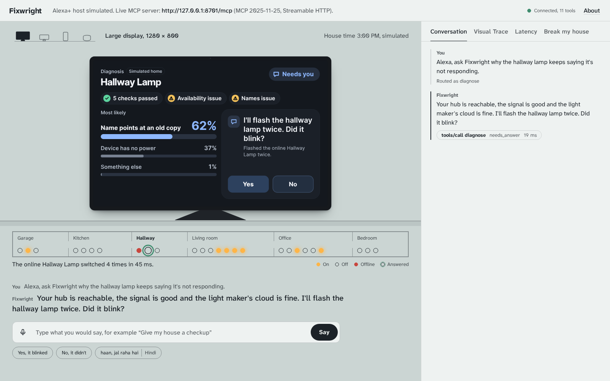
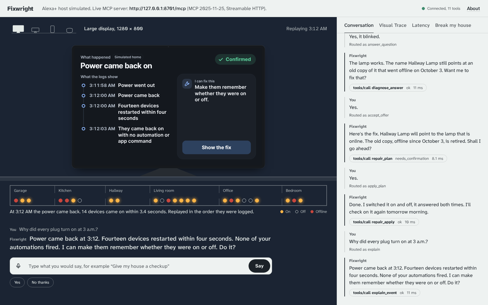
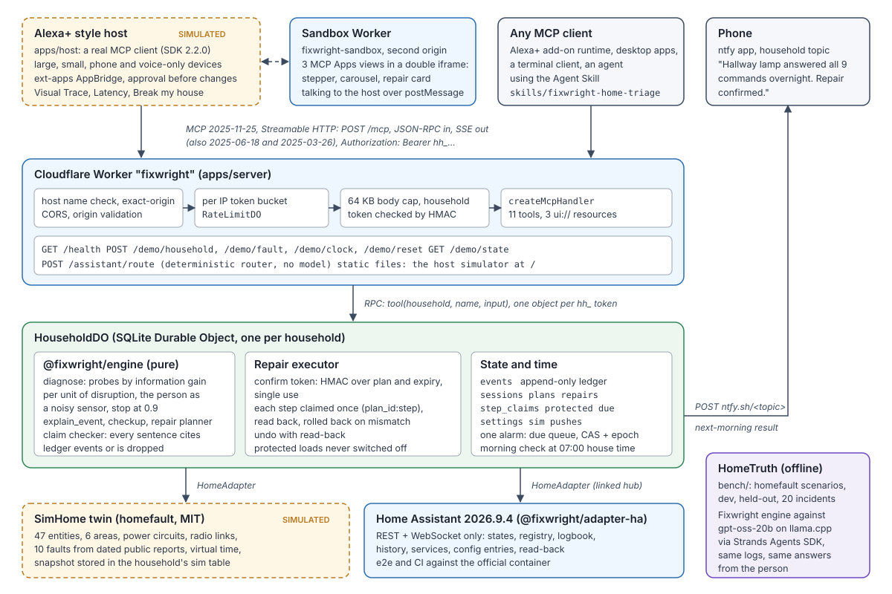

# Fixwright, the home doctor for Alexa+

A self hosted MCP server for Alexa+ (MCP spec 2025-11-25, Streamable HTTP) that finds out why a smart home device misbehaves, asks you to look when no sensor can tell, fixes it after your yes, and checks the next morning that the fix held.

- Live demo: https://fixwright.sampark-bhol.workers.dev
- MCP endpoint: https://fixwright.sampark-bhol.workers.dev/mcp
- Demo video: https://youtu.be/wprZUWRlDCs



## Why I built it

A lamp says it is not responding. You ask again and it works. A week later it fails again, and the usual advice is to delete your devices and set the whole house up from scratch. I wanted the assistant in the room to do what a good electrician does: test the likely causes in order, ask you one useful question, fix the real fault and come back to check.

## What it does

Say "Alexa, ask Fixwright why the hallway lamp keeps saying it's not responding."

1. **It tests before it guesses.** The hub answers, the signal is good, the light maker's cloud is fine. Two causes are left, so it asks the one sensor every home has: "I'll flash the hallway lamp twice. Did it blink?"
2. **It finds the real fault.** You say yes (or "haan"). The lamp works, so the problem is the name: "Hallway Lamp" still points at an old copy of the lamp left behind when it was paired again.
3. **It fixes it with your yes.** It shows what will change, waits for a yes, moves the name to the lamp that is online, switches it on and off to prove it answers, and rolls back by itself if anything does not read back.
4. **It checks the next morning.** Your phone gets a push: "Hallway lamp answered all 9 commands overnight. Repair confirmed."

It also explains strange events from the logs ("Power came back at 3:12. Fourteen devices restarted within four seconds. None of your automations fired."), runs a checkup that finds names that collide, low batteries and plugs that keep dropping off Wi-Fi, and never switches off a load you marked protected, like the strip that runs an aquarium filter.



## Try it

Open the live demo. Each browser gets its own demo house. Type or say:

1. "Why does the hallway lamp keep saying it's not responding?" then "Yes, it blinked." then "Yes." twice.
2. "Why did every plug turn on at 3 a.m.?" then "Yes." twice.
3. "Give my house a checkup."
4. "Alexa, ask Fixwright to turn off the living room power strip."
5. In **Break my house**, jump to the next morning, then ask "Did the hallway lamp fix hold?"

**Break my house** lets you cause any of ten faults. **Visual Trace** shows every JSON-RPC message with its timing, from `initialize` at 2025-11-25 to each `tools/call` and its `structuredContent`.

## How it works



- **The add-on** is a Cloudflare Worker running the official MCP TypeScript SDK v2, stateless, with eleven tools. Every tool returns one spoken line plus `structuredContent` that matches its `outputSchema`, and ids chain from one call to the next so a flow can finish on another device.
- **Each household** gets its own SQLite Durable Object: an append only ledger of everything the house and Fixwright did, the diagnosis sessions, repair plans, repairs, protected devices and a due queue that runs on one alarm.
- **The diagnosis** is a Bayesian model over ten causes. Each probe has a cost and a disruption level, and the next probe is the one that teaches the most for the least bother. People count as sensors with their own reliability. Fixwright only says Confirmed when every sentence it speaks is tied to an event in the ledger.
- **Repairs** are dry runs with a signed, single use confirm token. Each step runs at most once, is read back from the house and is rolled back on a mismatch. Undo replays the stored inverse steps.
- **The screens** are three MCP Apps views (diagnosis stepper, checkup carousel, repair card) built to the Alexa+ add-on design guide: 768 by 480 canvas, far field type, 48 px touch targets, light and dark, and a voice only path where the spoken line carries everything.
- **The host** plays the Alexa+ part. It is a real MCP client that renders the views in a sandbox on a second origin, switches between a large display, a small display, a phone and a voice only speaker in the middle of a conversation, and shows the house as a live floor plan.
- **Real homes** connect through the Home Assistant adapter (REST and WebSocket). The same repairs run against Home Assistant 2026.9.4 and are read back through its own API.

## Tools

| Tool | What it does | View |
| --- | --- | --- |
| `home_checkup` | Scans the house and returns 3 to 5 findings, most severe first | carousel |
| `diagnose` | Finds why one device misbehaves; may flash it and ask a question | stepper |
| `diagnose_answer` | Takes the person's reply, in English or Hindi | stepper |
| `explain_event` | Explains something the house did, from its logs | stepper |
| `repair_plan` | Dry run with the changes in plain sentences and a confirm token | stepper |
| `repair_apply` | Applies a plan after an explicit yes, with read back and rollback | repair card |
| `repair_status` | Shows how a repair is holding up, including the next morning check | repair card |
| `undo` | Puts an applied repair back, with read back | repair card |
| `protect_device` | Marks a device that must never be switched off | |
| `switch_device` | Switches a device unless that would cut a protected load | |
| `refresh_view` | View only: the latest result for an open view | |

## HomeTruth benchmark

I built HomeTruth to measure diagnosis instead of claiming it: 720 scenarios with known causes (500 development, 200 held out, 20 incidents rebuilt from dated public reports), scored on whether the right cause comes first and how often a verdict marked Confirmed is wrong. Next to Fixwright I ran gpt-oss-20b through the Strands Agents SDK, once with the logs alone and once with the answers to Fixwright's questions.

- **Fixwright's questions are what make the difference.** The same LLM went from 71 of 100 held out scenarios with the logs alone to 83 of 100 once it had the answers to Fixwright's questions, fixing 12 diagnoses and breaking none (exact McNemar p 0.0005).
- **Fixwright knows when it knows.** When it names a cause it is right 78 times out of 81 (96%), because it says "I can't tell yet" instead of guessing. The LLM reading the logs is right 71 times out of 96 (74%).
- **On the 20 rebuilt incidents** Fixwright got 16 right with no false confirmations. The LLM with the logs got 16 right with 2.
- **Across all 720 scenarios** Fixwright puts the right cause first 82% of the time, in about a millisecond per diagnosis.

Every number comes from `bench/results/HOMETRUTH.txt`. Rerun Fixwright on every scenario in seconds with `npm run bench -w @fixwright/bench -- --agents fixwright --set all`.

## Run it locally

Node 22 on Linux or macOS.

```sh
npm ci
npm run dev:up      # MCP server and host on http://127.0.0.1:8701, sandbox on 8702
npm run e2e         # the whole demo story in headless Chromium
npm run check       # typecheck and tests for every workspace
npm run dev:down
```

Any MCP client can talk to the same server. A plain client with no SDK:

```sh
npm run mcp:plain -- https://fixwright.sampark-bhol.workers.dev/mcp
```

With a local Home Assistant 2026.9.4, `npm run e2e:ha` runs the power cut story against a real hub.

## Deploy for free (Cloudflare Workers)

```sh
npm ci
npx wrangler login
npm run build -w @fixwright/sandbox
cd apps/sandbox && npx wrangler deploy --var HOST_ORIGINS:https://fixwright.<subdomain>.workers.dev && cd ../..
npm run build -w @fixwright/views
SANDBOX_URL=https://fixwright-sandbox.<subdomain>.workers.dev/sandbox.html npm run build -w @fixwright/host
cd apps/server
npx wrangler deploy
npx wrangler secret put CONFIRM_SECRET   # 32 or more random characters
curl https://fixwright.<subdomain>.workers.dev/health
```

The free plan covers it: no card, SQLite Durable Objects included.

## AWS Builder: Strands Agents SDK

The LLM baselines in HomeTruth run on the Strands Agents SDK for TypeScript. `bench/llm/src/strands-client.ts` builds a Strands `OpenAIModel` pointed at a local llama.cpp server running gpt-oss-20b, creates a fresh `Agent` per scenario with a strict JSON schema for the answer, and `bench/src/agents/llm.ts` runs both baselines through it. The final run made 165 Strands calls with no failures.

## Agent Skill

`skills/fixwright-home-triage/SKILL.md` teaches any agent the checkup, diagnose, plan, yes, apply and status flow, how to ask for consent, the protected load rule, and how to phrase replies for a voice only speaker.

## Security

Fixwright never touches locks, garage doors or alarms, never switches off a protected device, and changes nothing without an explicit yes. Repairs use signed single use confirm tokens and run each step at most once with read back and rollback. Every household is isolated in its own Durable Object, linked hub tokens are encrypted with AES-GCM, and the server checks origins, rate limits requests and sends strict security headers. Details are in `SECURITY.md`.

## Repository map

| Path | What it is |
| --- | --- |
| `packages/protocol` | Shared types, zod schemas for every tool input and output, tool definitions |
| `packages/engine` | Diagnosis, explanation, checkup, claim checker, repair planner, phrasing |
| `packages/router` | Turns what the person said into the right tool call |
| `packages/homefault` | Open source smart home twin, fault library, scenario format and benchmark runner |
| `packages/adapter-ha` | Home Assistant adapter with fixtures and fault injection |
| `apps/server` | Cloudflare Worker: MCP server, household Durable Object, push |
| `apps/views` | MCP Apps views: stepper, carousel, repair card |
| `apps/host` | The Alexa+ style host with the live house plan |
| `apps/sandbox` | Sandbox Worker for the views' second origin |
| `bench` | HomeTruth benchmark and the LLM baselines |
| `skills` | Agent Skill |
| `e2e`, `scripts` | End to end tests and the local dev stack |

Builder notes for the Alexa+ team are in `FRICTION_LOG.md` and `PRODUCT_FEEDBACK.md`.

## License

MIT. See `LICENSE` and `NOTICE`.
